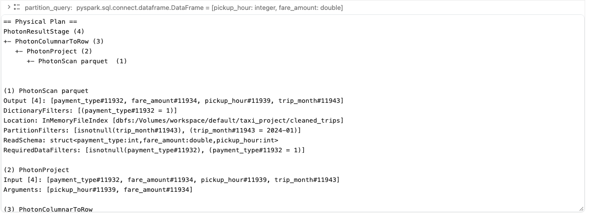
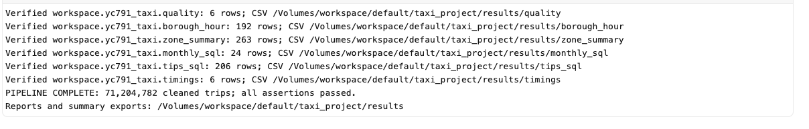
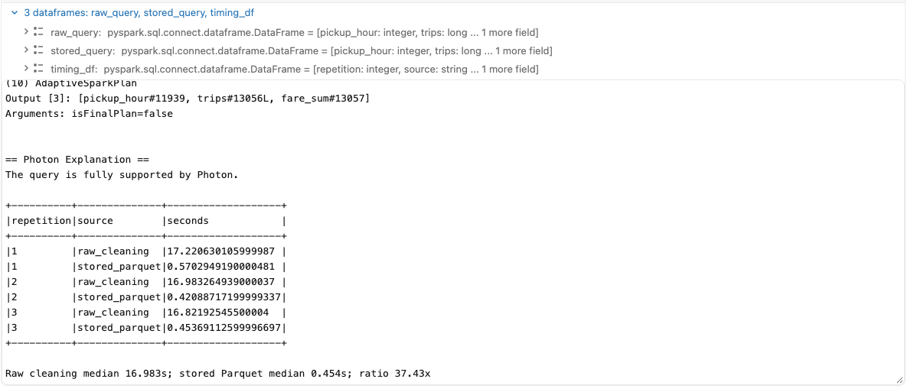
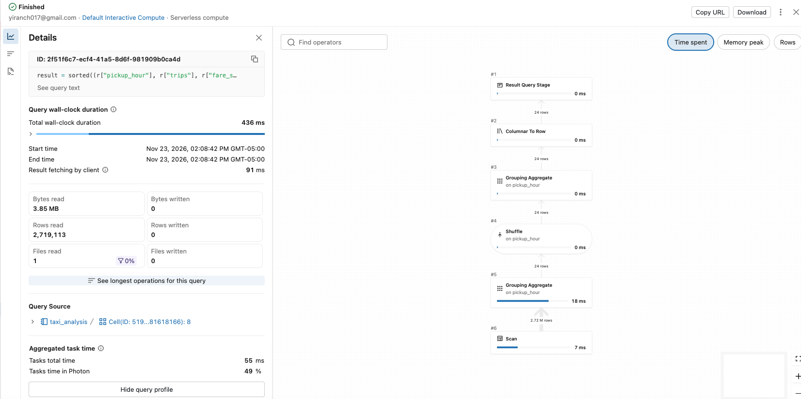

# NYC yellow taxi demand, travel time, and fares

Yiran Chen · IDS706 · Week 12

I used PySpark to analyze 79,479,946 yellow taxi trip records from 2023–2024. The pipeline downloads and validates the source files, normalizes monthly schemas, cleans the trips, joins pickup-zone names, and writes month-partitioned Parquet and summary tables. I compare recorded activity, trip duration, base fares, and credit-card tipping across locations and hours.

## Data and execution

The sources are the [NYC TLC monthly trip records and taxi-zone lookup](https://www.nyc.gov/site/tlc/about/tlc-trip-record-data.page). Each trip row describes a recorded ride; the lookup maps location IDs to zone and borough names. Field definitions follow the [yellow taxi data dictionary](https://www.nyc.gov/assets/tlc/downloads/pdf/data_dictionary_trip_records_yellow.pdf).

The 24 monthly trip files total **1,328,745,331 bytes (1.237 GiB)**, exceeding the 1 GB requirement before decompression. The notebook prints each file's URL-derived name, byte size, and SHA-256 checksum. It reads the Parquet files with Spark, casts the selected fields consistently, and unions the months without collecting trip-level data on the driver.

The notebook ran on **Spark 4.2.0 with Databricks Serverless and Photon**, using the `America/New_York` session timezone. All 16 code cells have recorded outputs, no error outputs are present, and the final cell confirms **71,204,782 cleaned trips; all assertions passed**. The original executed notebook and Databricks HTML export are included.

## Questions and methods

I ask which pickup zones and hours have the most recorded trips, when rides have longer durations or higher base fares, and how recorded credit-card tip percentages vary by zone. Trip counts describe recorded activity rather than unmet demand. Longer average durations do not establish lower traffic speeds because distance and route mix can also change. Base fares are metered charges rather than driver earnings.

The pipeline uses multiple early filters, `withColumn` transformations for duration, pickup month/hour, fare per mile, and credit-card tip percentage, and grouped counts, means, and approximate medians. A broadcast left join adds the small zone lookup. Two SQL queries calculate monthly activity and fares, and zone-level tipping with at least 1,000 usable credit-card observations. Separate cells demonstrate constructing lazy transformations and requesting a result with `show()`.

## Cleaning and integrity checks

I retain cash and credit-card rides with positive, finite base fares and finite totals at least as large as the base fare. Pickup timestamps must belong to 2023–2024 and match their source reporting month. Durations must be above zero and no more than 180 minutes; distances must be above zero and no more than 100 miles. These upper bounds define the sample for this analysis rather than an official TLC validity standard.

| First failing rule | Excluded records |
| --- | ---: |
| Invalid timestamp or source month | 1,150 |
| Invalid duration | 89,501 |
| Invalid distance | 1,527,668 |
| Invalid fare | 1,034,114 |
| Other payment/status code | 5,622,731 |
| **Total excluded** | **8,275,164** |
| **Retained** | **71,204,782** |

The quality categories are mutually exclusive and reconcile to all 79,479,946 input records. The retained share is **89.59%**. I preserve missing tips rather than treating them as zero, and I do not deduplicate identical-looking records because the selected fields do not establish a unique trip identifier.

The lookup has one row per location ID. The left join preserves all **71,204,782** retained trips, with **zero unmatched zone IDs**. However, **436,608 trips** have a borough labeled `Unknown` or `N/A`; matching a reference key does not guarantee a usable geographic category. Grouped totals and the saved Parquet row count are checked against the retained total.

## Findings

| Finding | Observed result |
| --- | --- |
| Busiest pickup zone | JFK Airport: **3,675,081 trips** |
| JFK average base fare and duration | **$64.22** and **43.11 minutes** |
| Second-busiest zone | Upper East Side South: **3,481,884 trips** |
| Busiest pickup hour | **18:00–18:59**, with **5,078,067 trips** |
| Hour with longest average duration | **15:00–15:59**, averaging **19.64 minutes** |

Airport trips account for substantial recorded activity and have a different fare and duration profile from many Manhattan pickup zones. For example, Upper East Side South averages **$13.10** in base fare and **11.99 minutes**, compared with JFK's **$64.22** and **43.11 minutes**. These are descriptive zone comparisons and do not hold trip distance or destination constant.

The tipping query exposes a limitation of ranking the arithmetic mean of per-trip percentages. `Outside of NYC` has a reported mean of **721.33% of base fare** across **10,227** usable credit-card records, while Baisley Park is **265.96%**. I treat these as warning signs for extreme ratios or anomalous records, not as typical customer behavior. A very small fare denominator or an extreme tip can strongly influence the mean; the current outputs do not establish which mechanism explains these particular zones. A follow-up would inspect the denominator distribution and compare medians with the ratio of total tips to total fares before interpreting the ranking. Cash tips are absent from the source, so the analysis cannot compare actual tipping between cash and card customers.

## Performance analysis

I use native Spark expressions and select the required columns before expensive processing. The saved Parquet is partitioned by pickup month. In the recorded `2024-01` scan plan, `PartitionFilters` contains the month restriction, `DictionaryFilters` contains `payment_type = 1`, and `ReadSchema` contains only payment type, fare, and pickup hour. This provides separate evidence of partition pruning, scan-level filtering, and column pruning; computed timestamp and duration conditions in the raw lineage still require evaluating expressions. The raw benchmark's recorded plan contains all 24 monthly scan branches with the cleaning predicates, so I do not assume the raw monthly layout eliminated those branches.

Repeated raw-data scanning and cleaning is the main measured performance bottleneck in this comparison. For the same January 2024 hourly trip counts and fare sums, the median raw-lineage action took **16.983 seconds**, compared with **0.454 seconds** over the saved Parquet, a **37.43× raw/stored ratio**. Results agree within the notebook's numerical tolerance. This combines the effects of materializing the cleaning work, selecting fewer stored columns, and the partitioned layout; it is not an isolated causal estimate of partitioning. The cleaned-data write took **29.054 seconds**, which is excluded from the repeated-action comparison. The small zone table uses a recorded `PhotonBroadcastHashJoin` with an `EXECUTOR_BROADCAST` stage, avoiding a large-side join shuffle. Partial/final aggregations and global sorting still show exchange operators, so I avoid an additional unconditional repartition rather than claiming that every shuffle disappears.

I warm both query variants and alternate their order over three repetitions. Caching did **not** improve this small repeated query: caching **2,719,113 rows** took **8.013 seconds** including materialization, and median action time was **0.342 seconds uncached** versus **0.467 seconds cached**. There was no observed break-even in these measurements. The cached plan reads a serverless checkpoint-cache snapshot, so the result should not be described as a guaranteed in-memory speedup. The saved-query profile reports **436 ms wall-clock duration**, **2,719,113 rows** and **3.85 MB** read from **one file**, producing **24 hourly groups**. The largest displayed operator time is the local grouping aggregate at **18 ms**, compared with **7 ms** for the scan; client result fetching is **91 ms**. These operator/task metrics need not add up to wall-clock duration. Shared compute, planning and result-transfer overhead, and warm storage caches limit the interpretation of wall-clock comparisons. The separate lazy-evaluation demonstration took **0.000897 seconds** to construct its transformations and **0.419 seconds** for the `show()` action; these timings illustrate the boundary without proving the absence of metadata or planning calls during construction.

| Repetition | Rebuild raw cleaning, seconds | Read stored Parquet, seconds |
| --- | ---: | ---: |
| 1 | 17.221 | 0.570 |
| 2 | 16.983 | 0.421 |
| 3 | 16.822 | 0.454 |
| **Median** | **16.983** | **0.454** |

## Outputs and reproducibility

The large cleaned dataset stays in `/Volumes/workspace/default/taxi_project/cleaned_trips`, partitioned by month. The six summary datasets are also saved as Delta tables under `workspace.yc791_taxi`; the notebook verifies each Delta and CSV row count on read-back:

| Result | Rows |
| --- | ---: |
| Quality summary | 6 |
| Borough/hour summary | 192 |
| Zone summary | 263 |
| Monthly SQL summary | 24 |
| Tipping SQL summary | 206 |
| Benchmark timings | 6 |

This repository includes the full displayed borough/hour and monthly tables extracted from the executed notebook. The two zone CSVs contain only the **top 20 displayed rows**, as their filenames indicate; the complete zone tables remain in Databricks. Extracted tables preserve the displayed values rather than rerunning or inventing results. `outputs/RUN_REPORT.md` retains the notebook's original generated interpretations, while the discussion above adds the observed tipping and caching limitations.

To reproduce the run, import `taxi_analysis.ipynb` into Databricks, select Serverless, and run all cells. It creates a dedicated volume and schema, downloads the public inputs, verifies the combined file size and checksums, and refreshes the project outputs. If notebook network access cannot download the source files, run `python3 download_data.py --destination raw` locally and upload the resulting files and manifest to the project's `raw` volume directory. No raw or cleaned trip files belong in GitHub.

## Execution evidence

- [Executed notebook](taxi_analysis.ipynb)
- [HTML export with recorded outputs](taxi_analysis.html)
- [Physical plans and timing outputs](outputs/execution_plans_and_timings.txt)
- [Partition/filter plan excerpt](evidence/execution_plan_excerpt.txt)
- [Successful final-cell output](evidence/pipeline_success.txt)

### Partition pruning and column selection

### Successful pipeline execution

### Repeated-query timings

### Databricks Query Details

